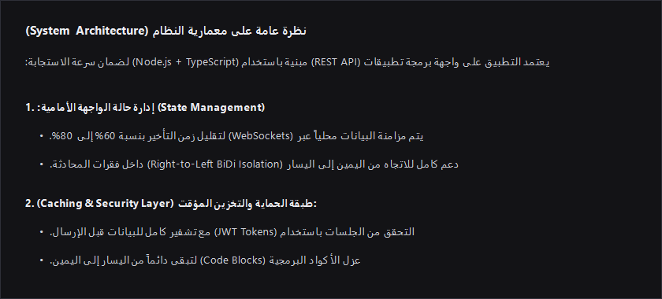
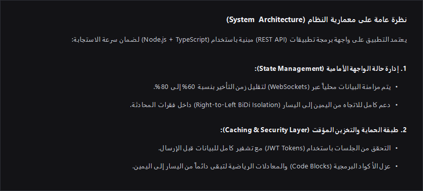

<div align="center">
  
  <h1>antigravity-plugins</h1>
  <p>Clean, native plugins and UI extensions for <strong>Google Antigravity 2.0</strong>.</p>
  <p>
    <a href="#plugins">Plugins</a> ·
    <a href="#quick-install">Install</a> ·
    <a href="plugins/arabic-rtl-fixer/README.md">Documentation</a> ·
    <a href="LICENSE">License</a>
  </p>
  <p>
    
    
    
  </p>
</div>

---

## Plugins

| Plugin | Version | Platforms | Summary |
| :--- | :---: | :---: | :--- |
|  **[arabic-rtl-fixer](plugins/arabic-rtl-fixer/README.md)** | `v1.5.0` | Windows · Linux / Omarchy · macOS | Native RTL/BiDi rendering for Arabic, Hebrew, and Persian prose, lists, tables, and callouts — plus a self-updating Antigravity sidecar panel. |

---

## Quick Install

Install `arabic-rtl-fixer` with one command. No restarts beyond reopening Antigravity (`Ctrl + Shift + N`).

**Windows (PowerShell):**

```powershell
irm https://raw.githubusercontent.com/3B00D-0/antigravity-plugins/main/install.ps1 | iex
```

**Linux / Arch / Omarchy / macOS (Bash):**

```bash
curl -fsSL https://raw.githubusercontent.com/3B00D-0/antigravity-plugins/main/install.sh | bash
```

---

## Showcase — `arabic-rtl-fixer`

| Before *(Default Antigravity)* | After *(`arabic-rtl-fixer`)* |
| :---: | :---: |
|  |  |
| *Mixed Arabic/English sentences split, numbers and bullets lock left, parentheses flip.* | *Natural RTL flow, isolated LTR inline code & math, right-aligned markers and borders.* |

---

## Repository Layout

```text
antigravity-plugins/
├── install.ps1                        # Root installer (Windows)
├── install.sh                         # Root installer (Linux / Omarchy / macOS)
├── LICENSE                            # MIT License
└── plugins/
    └── arabic-rtl-fixer/
        ├── plugin.json                # Antigravity plugin manifest
        ├── assets/                    # Brand SVG mark & comparison screenshots
        ├── lib/
        │   ├── injection.js           # Client BiDi CSS + MutationObserver engine
        │   └── patcher.cjs            # Cross-platform ASAR & integrity patcher
        ├── sidecars/rtl_fixer_panel/  # Theme-synced sidecar UI & update server
        ├── test/bidi.test.js          # Automated BiDi regression tests
        ├── install.ps1 / install.sh   # Standalone installers
        └── README.md                  # Full plugin documentation
```
