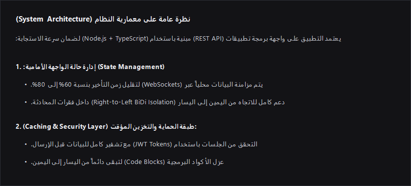
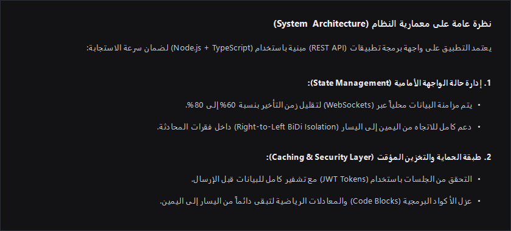

<div align="center">
  
  <h1>arabic-rtl-fixer</h1>
  <p>Bidirectional (RTL/LTR) text rendering fix and Aux Pane control panel for Google Antigravity 2.0.</p>
</div>

---

## Overview

By default, Antigravity 2.0 mounts Markdown paragraphs (`<p>`), headings (`<h1>`–`<h6>`), and list items (`<li>`) inside a strict `direction: ltr` container without `unicode-bidi: plaintext` or `dir="auto"`. Whenever an Arabic paragraph contains an inline English term or parentheses, the browser's BiDi algorithm splits the line and reverses the sentence order.

`arabic-rtl-fixer` patches `preload.js` with a lightweight `MutationObserver` and CSS isolation layer, and registers a local UI sidecar in the Antigravity **Plugins** menu.

## Visual Comparison

| Before (Default Antigravity 2.0) | After (`arabic-rtl-fixer`) |
| :---: | :---: |
|  |  |

## Installation

Run in Windows **PowerShell**:

```powershell
irm https://raw.githubusercontent.com/3B00D-0/antigravity-plugins/main/plugins/arabic-rtl-fixer/install.ps1 | iex
```

After running, reopen Antigravity 2.0 (or press `Ctrl + Shift + N`).

## Technical Details

1. **BiDi Isolation (`preload.js`)**: Applies `unicode-bidi: plaintext` and per-element `dir="rtl"` / `dir="auto"` detection across `<p>`, `<h1>`–`<h6>`, `<li>`, `<ul>`, `<ol>`, `<blockquote>`, `<table>`, `<th>`, `<td>`, and the Lexical chat editor while keeping `<pre>`, `<code>`, and `.katex` strictly `ltr`.
2. **ASAR & Integrity Checksum Update**: Appends the updated `preload.js` to `resources/app.asar`, recalculates the Chromium Pickle header and SHA-256 block hashes, and updates the integrity resource in `Antigravity.exe` (saving `.bak` backups automatically).
3. **Sidecar Panel**: Installs under `~/.gemini/config/plugins/arabic-rtl-fixer` so you can check status, re-apply after app updates, or restore original files directly from the Antigravity **Plugins** tab.
