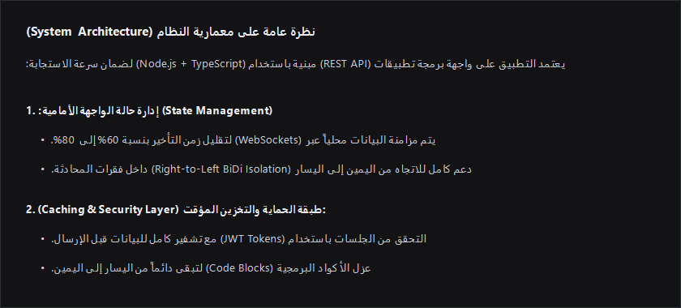
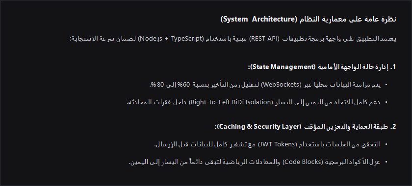

<div align="center">
  
  <h1>arabic-rtl-fixer</h1>
  <p>Bidirectional (RTL/LTR) text rendering fix and native sidecar panel for Google Antigravity 2.0.</p>
  <p>
    <a href="#installation">Install</a> ·
    <a href="#what-it-fixes">Features</a> ·
    <a href="#cli--verification">CLI &amp; Tests</a> ·
    <a href="../../README.md">All Plugins</a>
  </p>
  <p>
    
    
    
  </p>
</div>

---

## Overview

Antigravity 2.0 renders Markdown inside a strict `direction: ltr` container without prose-aware BiDi rules. Mixing Arabic (or Hebrew/Persian) with inline English identifiers, parentheses, numbers, Markdown tables, or code badges reverses sentence order and pins list markers to the wrong margin.

`arabic-rtl-fixer` resolves this directly in Antigravity's client preload layer and ships a native, theme-synced control panel under **Overview → Extensions → Arabic / RTL Formatting Fix**.

---

## Visual Comparison

| Before *(Default Antigravity)* | After *(`arabic-rtl-fixer`)* |
| :---: | :---: |
|  |  |

---

## What It Fixes

- **Prose & Headings**: Scores prose inside `<p>`, `<h1>`–`<h6>`, `<blockquote>`, and `<pre>` plaintext blocks (ignoring inline code/links so a sentence starting with `` `Backend API` `` still flows RTL when prose is Arabic).
- **Lists & Task Lists**: Sets `ul` / `ol` direction by item majority, preserves inline LTR code badges cleanly, and flips Markdown task-list checkboxes (`- [x]`) to the right edge.
- **Tables & Callouts**: Votes `table[dir="rtl|ltr"]` across cells and headers, re-evaluates dynamically as streaming responses arrive, and flips GitHub-style alert borders to the right margin for RTL callouts.
- **Strict Code & Math Isolation**: Keeps syntax-highlighted code blocks, inline `<code>`, and `.katex` formulas `ltr` with `unicode-bidi: isolate`.
- **Native Sidecar Panel**: Automatically adapts to Antigravity's active light/dark theme, displays live patch/runtime status, checks GitHub for updates, and restores clean backups in one click.

---

## Installation

**Windows (PowerShell):**

```powershell
irm https://raw.githubusercontent.com/3B00D-0/antigravity-plugins/main/plugins/arabic-rtl-fixer/install.ps1 | iex
```

**Linux / Arch / Omarchy / macOS (Bash):**

```bash
curl -fsSL https://raw.githubusercontent.com/3B00D-0/antigravity-plugins/main/plugins/arabic-rtl-fixer/install.sh | bash
```

After running, restart Antigravity (or press `Ctrl + Shift + N`).

> **Permissions on Linux:** System installs (such as `/opt/antigravity` or `/usr/lib/antigravity`) prompt with `sudo` during patching, or you can override the target path via `ANTIGRAVITY_DIR` or `ANTIGRAVITY_ASAR`.

---

## CLI & Verification

You can inspect status, re-apply, restore, or run the BiDi test suite directly from `~/.gemini/config/plugins/arabic-rtl-fixer`:

```bash
# Check patch state, Antigravity version, and backup status
node patch_antigravity_rtl.js --status

# Apply or upgrade the patch manually (Python fallback also available via patch_antigravity_rtl.py)
node patch_antigravity_rtl.js

# Restore original unpatched Antigravity files
node patch_antigravity_rtl.js --restore

# Run the automated BiDi regression suite
node --test test/bidi.test.js
```

---

## Architecture & Safety

1. **Non-Destructive Backups**: Refreshes `app.asar.bak` (and `Antigravity.exe.bak` on Windows) against the currently installed Antigravity version before writing, preventing stale backups from overwriting newer releases.
2. **Integrity Sync**: Recalculates Chromium Pickle headers, SHA-256 block hashes, and Windows `Antigravity.exe` embedded ASAR integrity automatically.
3. **Self-Healing Sidecar**: Re-applies the patch seamlessly after Antigravity auto-updates and supports in-app updates directly from this repository.
